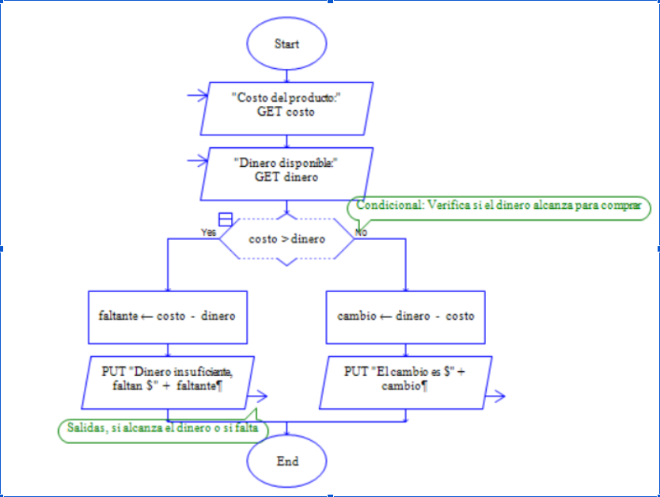
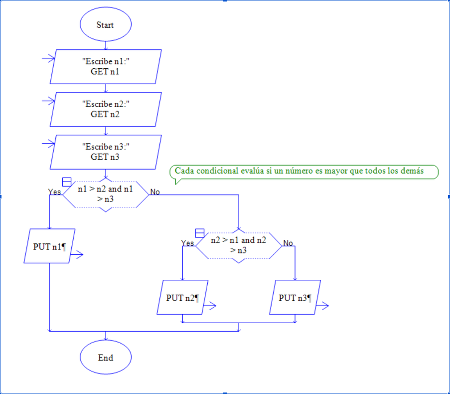
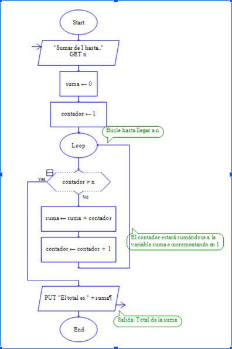
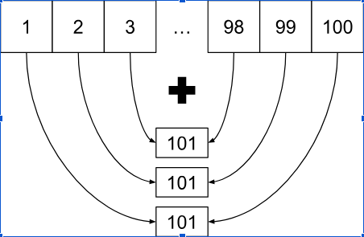
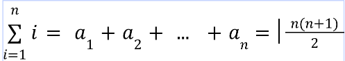
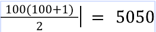
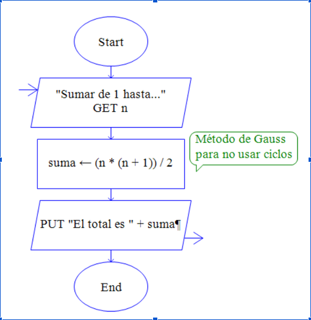

# Lección 0
## Programación

La programación consiste en organizar una secuencia de pasos ordenados a seguir para hacer cierta cosa. En el contexto de la informática, implica escribir instrucciones para que una computadora las ejecute una tras otra.

### Algoritmos y lógica

Algoritmo se refiere a “conjunto ordenado y finito de operaciones que permite hallar la solución de un problema” (Real Academia Española, s.f., definición 1). Lógica se refiere a “Ciencia que expone las leyes, modos y formas de las proposiciones en relación con su verdad o falsedad” (Real Academia Española, s.f., definición 6). En la programación creamos algoritmos para dar solución a problemas. Los algoritmos siguen una lógica para funcionar.

### Características de la lógica de la programación

- **Pensamiento ordenado:** Los algoritmos se escriben y ejecutan en una secuencia ordenada.
- **Base universal:** Resolución de problemas: está hecha para facilitar la capacidad de la computadora de ejecutar acciones.
- **Resolución de problemas:** Está hecha para facilitar la capacidad de la computadora de ejecutar acciones.

La programación se rige principalmente por el uso de estructuras de datos, condicionales y repeticiones.

### Diagramas de flujo

Un diagrama de flujo es una representación gráfica de un algoritmo o proceso, compuesto de recuadros que tienen una acción definida.

El diagrama de flujo se sigue a través de las flechas, llamadas líneas de flujo. Estas separan una acción tras otra y se pueden desviar o regresar a acciones anteriores, siempre y cuando se siga la dirección en la que apuntan.

### Elementos del diagrama de flujo

### Manejo de datos

La programación se desarrolló con el propósito principal de manejar valores y datos automáticamente, para omitir procesos manuales.

Alan Turing, padre de la informática, sentó las bases para la primera computadora programable. Si bien no la creó, su trabajo para descifrar Enigma, un método de encriptación de mensajes utilizado por los alemanes en la Segunda Guerra Mundial, siguió ese propósito de la programación.

En su momento, el trabajo de los criptógrafos se hacía enteramente a lápiz y papel, hasta que Turing inventó una máquina gigantesca que ayudó a romper la encriptación; los datos eran los mensajes de los alemanes.

*Alan Turing*

### Condiciones

Un recurso fundamental en la programación es el uso de condiciones y compuertas lógicas. Esto es, que una instrucción se ejecute cuando algo se cumpla y combinar condiciones de diferente manera.

Las condiciones realizan una instrucción si son verdaderas, y pueden omitirse o realizar algo diferente si son falsas.

### Compuertas lógicas

Además de analizar condiciones, estas se pueden comparar una con otra a través de operadores lógicos, como los siguientes:

- **OR:** Si una de las dos se cumple, `true`.
- **AND:** Si ambas se cumplen, `true`.
- **NOT:** Opuesto (`true = false`, `false = true`).
- **NOR:** Si una de las dos se cumple, `false`.
- **NAND:** Si ambas se cumplen, `false`.
- **XOR:** Si son iguales (`true & true`, `false & false`), `false`.
- **XNOR:** Si son iguales (`true & true`, `false & false`), `true`.

Todo esto se da a entender mejor en las llamadas tablas de verdad:

**Notemos también la manera en la cual se representan gráficamente.**

Prácticamente toda la programación se basa en cosas que se cumplen o no, ya que, a nivel de hardware, un cable o un transistor de computadora solo puede estar encendido o apagado; es decir, `true` o `false`.

### Repeticiones

Otro aspecto importante de los algoritmos es que, si realizan la misma acción múltiples veces, es conveniente programar un ciclo o repetición para omitir escribir las instrucciones muchísimas veces. Los ciclos se rigen por condiciones: se repiten mientras algo se cumpla o una cantidad determinada de veces.

Se puede usar una condición que evalúe si es verdadera o falsa, o utilizar un contador para hacerlo cierta cantidad de veces. Esto se llama bucle `while` y bucle `for`, respectivamente.

*Representación visual de los bucles while y for, respectivamente.*

### Problemas con RAPTOR (diagramas de flujo)

Vamos a resolver un par de ejercicios usando los diagramas de RAPTOR para familiarizarnos con los diagramas y el manejo de datos. La entrada y salida de datos del usuario es fundamental para resolverlos; esto es, que quien ejecuta un código de RAPTOR pueda introducir valores y recibir otros como respuesta.

### Ejercicio 1: Dinero suficiente

Imagina que vas al supermercado a comprar un producto que tiene cierto costo y tú llevas una cantidad de dinero para pagarlo. Escribe un código que use un condicional para determinar si te alcanza el dinero para comprarlo y mostrar tu cambio, o si no te alcanza y la cantidad que te falta.

Para determinar el costo y el dinero que llevas, declara variables que contengan uno de los valores cada una y pídelos con una entrada.

#### Ejemplo 1

#### Entrada
<pre>
5 5
</pre>

#### Salida
<pre>
SI
400 0
</pre>

#### Ejemplo 2

#### Entrada
<pre>
5 10
</pre>

#### Salida
<pre>
SI
5
</pre>

#### Ejemplo 3

#### Entrada
<pre>
10 5
</pre>

#### Salida
<pre>
NO
5
</pre>

<button class="problemO" onclick="mostrarSolucion()" style="border: none; background-color: #f7f8fc; font-size: 16px; cursor: pointer; padding: 8px 12px; border-radius: 5px;">
  <strong>Solución</strong> ▼
</button>

  
  <strong>
  Explicación (Proceso del diagrama)
  </strong>
  <ul>
    <li>Inicio.</li>
    <li>Pedir el costo del producto.</li>
    <li>Pedir el dinero disponible.</li>
    <li>Condición: ¿El costo es mayor que el dinero?</li>
    <li>Yes</li>
    <li>Declarar faltante como costo - dinero.</li>
    <li>Mostrar mensaje de insuficiente, y faltante.</li>
    <li>No</li>
    <li>5. Declarar cambio como dinero - costo.</li>
    <li>6. Mostrar cambio</li>
    <li>Fin</li>
</ul>

  

  

### Ejercicio 2: Número más grande
Dados 3 números, determina cuál es el mayor de ellos con condicionales.

#### Ejemplo 1

#### Entrada
<pre>
1 2 3 
</pre>

#### Salida
<pre>
3
</pre>

#### Ejemplo 2

#### Entrada
<pre>
8 10 14 
</pre>

#### Salida
<pre>
14
</pre>

#### Ejemplo 3

#### Entrada
<pre>
10 5 3
</pre>

#### Salida
<pre>
10
</pre>

<button class="problem1" onclick="mostrarSolucionTwo()" style="border: none; background-color: #f7f8fc; font-size: 16px; cursor: pointer; padding: 8px 12px; border-radius: 5px;">
  <strong>Solución</strong> ▼
</button>

  
  <strong>
  Explicación (Proceso del diagrama)
  </strong>
  <ul>
    <li>Si n1 es más que los demás, n1 es el mayor.</li>
    <li>Si no, si n2 es más que los demás, n2 es el mayor.</li>
    <li>Si no, n3 es el mayor.</li> 
  </ul>
  Con esto nos damos cuenta de que se pueden hacer condicionales dentro de otros.

  

### Ejercicio 3: Sumar de 1 a N. 
Dado un número que llamaremos n, calcula la suma de los números de 1 hasta n, es decir

1 + 2 + 3 + … + n

Cabe mencionar que n es un número entero positivo, de modo que no vas a sumar números negativos ni decimales.

#### Ejemplo 1

#### Entrada
<pre>
100
</pre>

#### Salida
<pre>
5050
</pre>

#### Ejemplo 2

#### Entrada
<pre>
5
</pre>

#### Salida
<pre>
15
</pre>

#### Ejemplo 3

#### Entrada
<pre>
6
</pre>

#### Salida
<pre>
21
</pre>

<button class="problem2" onclick="mostrarSolucionTre()" style="border: none; background-color: #f7f8fc; font-size: 16px; cursor: pointer; padding: 8px 12px; border-radius: 5px;">
  <strong>Solución</strong> ▼
</button>

   
  <strong>
  Explicación (Proceso del diagrama)
  </strong>
  

  Utilizaremos el contador para irlo sumando a una variable suma, que guarda el resultado y lo devuelve al terminar el bucle.
  

  

  El segundo método es aplicando un patrón matemático que podemos notar. Tomemos de ejemplo una suma del 1 al 100:
  

   

  <strong>Solución más eficiente</strong>
  

  Si sumamos el primer número con el último tendremos el mismo resultado que sumando el segundo con el penúltimo, y que el tercero con el antepenúltimo, y así sucesivamente. Esto lo podemos emplear para realizar una multiplicación de n + 1 la cantidad de veces n / 2:
  

  
  

  Siendo n un entero positivo, sumando números enteros de 1 hasta n, se puede resolver con una sola operación.
  

  

  Para el caso de n = 100, se resuelve como:
  
  

  Este procedimiento lo ideó el matemático Carl Gauss desde pequeño, y en RAPTOR se representa  con un algoritmo mucho más pequeño de esta manera:
  

  

